# Customer Support AI Agent on Amazon Bedrock AgentCore

A customer support agent built with the Strands Agents SDK and deployed to Amazon Bedrock AgentCore Runtime. It tracks orders, processes refunds, answers policy questions from a knowledge base, remembers customers across sessions, calculates loyalty discounts in a sandbox, and can browse live web pages.

## Features

| Capability | Implementation |
|---|---|
| Cloud runtime | `BedrockAgentCoreApp` with an `@app.entrypoint` handler, deployed with `agentcore deploy` |
| External tools (MCP) | `MCPClient` connected to an AgentCore Gateway exposing an API-based target and Lambda targets (`order_tracker`, `refund_processor`) |
| RAG | `search_knowledge_base` tool calling the Bedrock Knowledge Base `Retrieve` API |
| Long-term memory | `MemoryHook` (`HookProvider`) with `get_namespaces`, `retrieve_customer_context` and `save_support_interaction` |
| Computation | `calculate_loyalty_discount` runs business rules in AgentCore Code Interpreter, with a tier-only fallback |
| Web browsing | `AgentCoreBrowser(region=REGION)` added to the agent's tools |

## Architecture

```
Customer ──> AgentCore Runtime (Strands Agent, Nova 2 Lite)
                 ├── Gateway (MCP) ──> Order API / Lambda: order_tracker / Lambda: refund_processor
                 ├── Knowledge Base (Retrieve)
                 ├── AgentCore Memory (semantic + preference strategies)
                 ├── Code Interpreter (loyalty maths)
                 └── AgentCore Browser (live pages)
```

## Project structure

```
starter/
├── main.py                  # Agent, tools, memory hook, entrypoint
├── requirements.txt         # Dependencies used for deployment
├── pyproject.toml / uv.lock # Local environment (uv)
├── lambda/                  # Order tracker and refund processor Lambdas + schema
├── product_catalog.txt      # Source content for the knowledge base
├── run_tests.py             # End-to-end test script
├── test_gateway.py          # Gateway connectivity check
├── setup_permissions.py     # Helper for IAM permissions
├── reflection.md            # Written reflection
└── screenshots/             # Deployment and test evidence
```

## Setup

Requires Python 3.13, [uv](https://docs.astral.sh/uv/), and AWS credentials for `us-east-1`.

```powershell
cd starter
uv venv --python 3.13
.\.venv\Scripts\Activate.ps1
uv pip install -r requirements.txt
```

Set your resource values near the top of `main.py`:

```python
GATEWAY_URL = "https://<alias>.gateway.bedrock-agentcore.us-east-1.amazonaws.com/mcp"
KB_ID       = "<knowledge-base-id>"
REGION      = "us-east-1"
MEMORY_ID   = "<memory-id>"
```

## Deploy

```powershell
agentcore configure --entrypoint main.py
agentcore deploy
```

The execution role needs permissions for Bedrock model invoke, `bedrock:Retrieve` on the knowledge base, AgentCore Memory, Code Interpreter, Gateway, and Browser (including `ConnectBrowserAutomationStream`).

## Invoke

```powershell
agentcore invoke '{"prompt": "Can you track order ORD-001?", "customer_id": "CUST-123", "session_id": "t1"}'
```

On Windows PowerShell, passing JSON directly can strip quotes. `run_tests.py` builds the call from Python to avoid this:

```powershell
python run_tests.py
```

## Test evidence

### Infrastructure

| Evidence | Screenshot |
|---|---|
| Agent deployed to AgentCore Runtime | 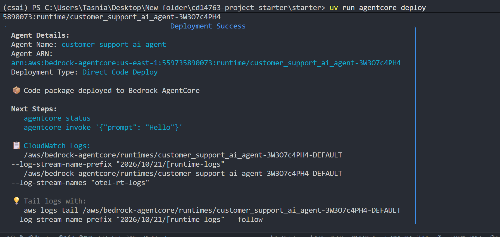 |
| API target in the Gateway | 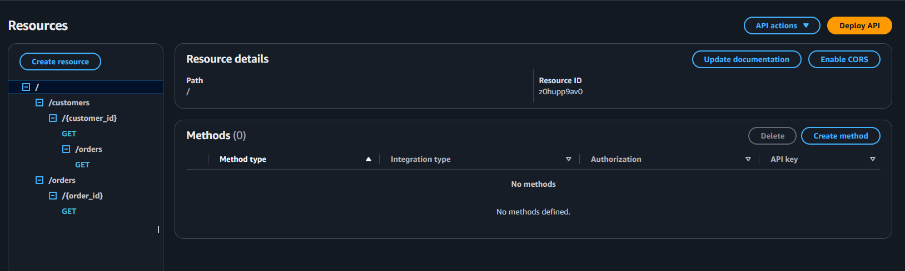 |
| Lambda functions | 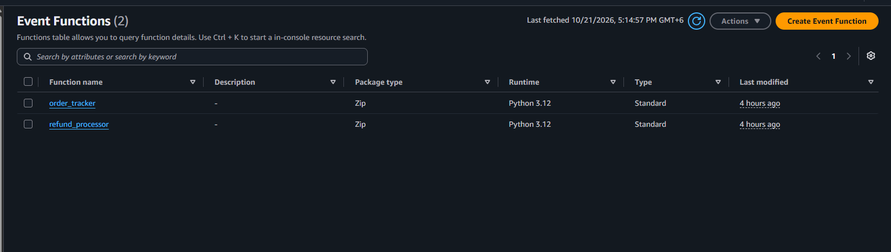 |
| Gateway IAM permissions | 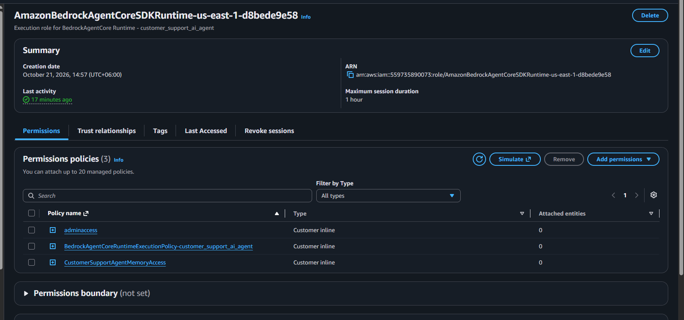 |
| Knowledge base | 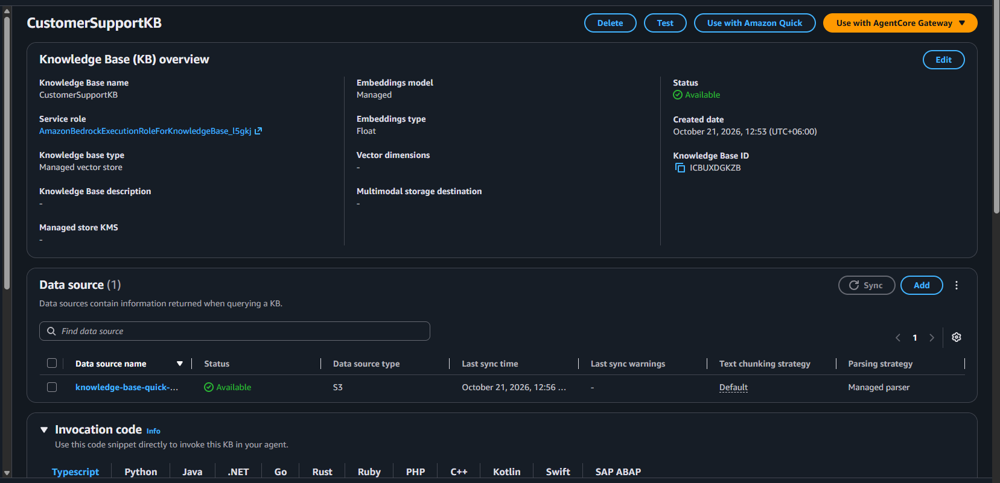 |
| Knowledge base check | 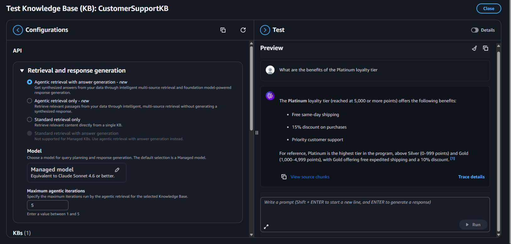 |

### Agent tests

| Test | Screenshot(s) |
|---|---|
| 1. Order tracking (Gateway tool) | 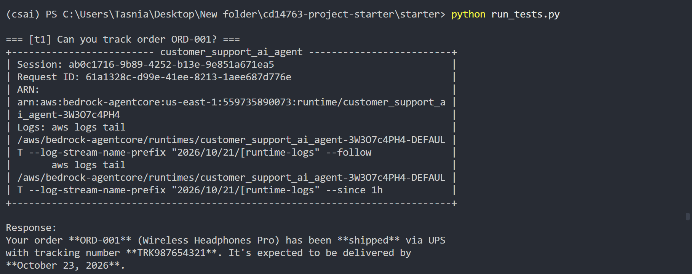 |
| 2. Refund processing (Gateway tool) | 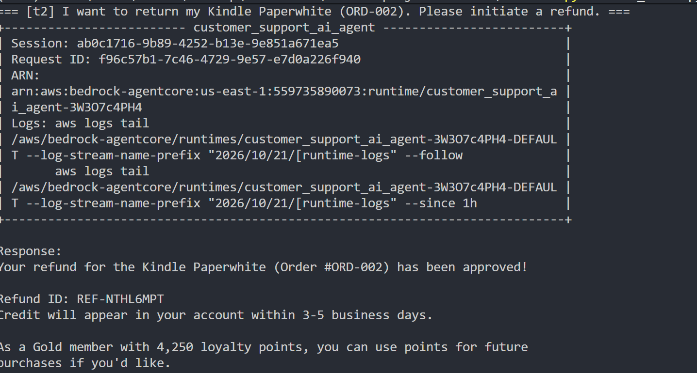 |
| 3. Knowledge base retrieval | 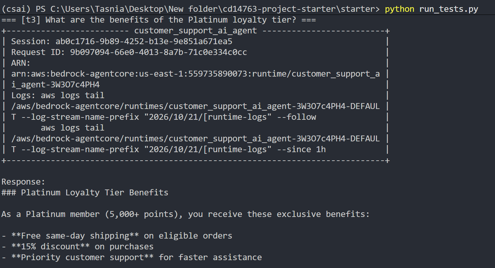 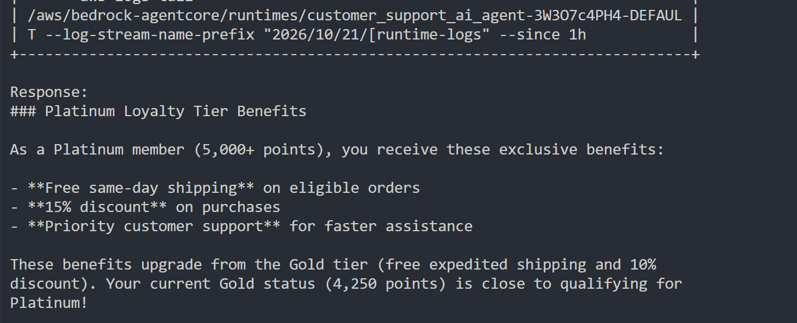 |
| 4. Cross-session memory (same customer, two sessions) | 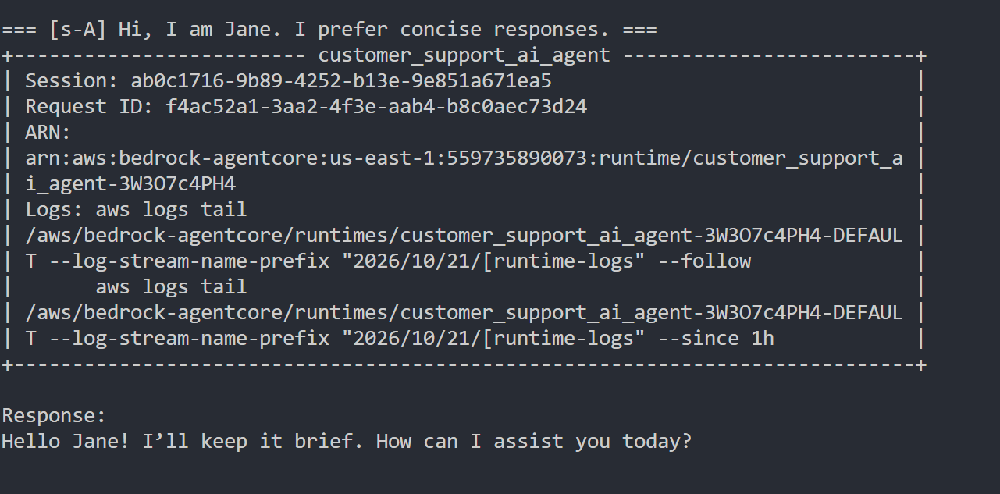 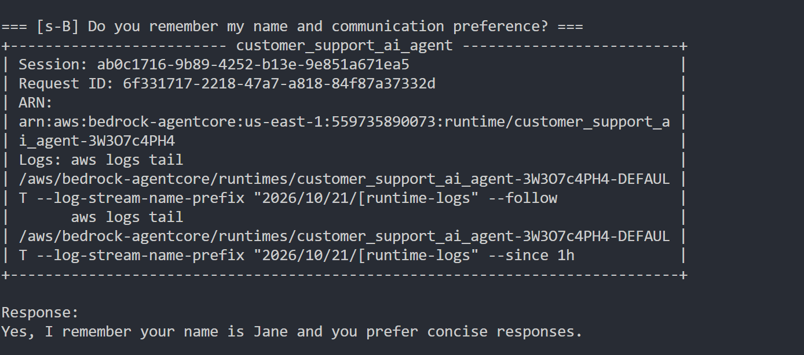 |
| 5. Loyalty discount (Code Interpreter) | 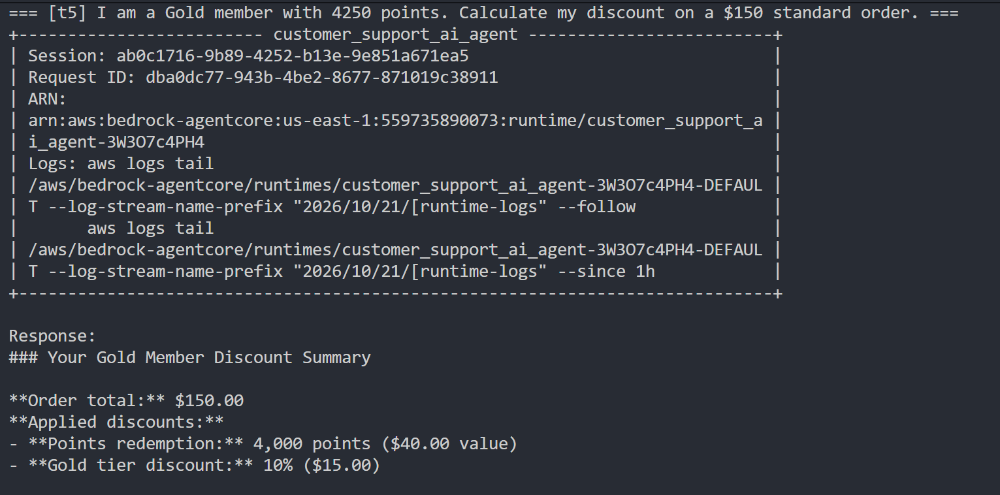 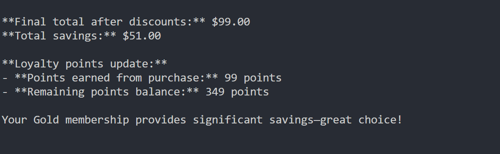 |
| 6. Live web page retrieval (Browser) | 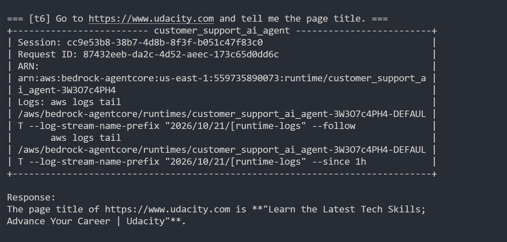 |

## Reflection

See [starter/reflection.md](starter/reflection.md) for design decisions, challenges, and production considerations.

## Notes and limitations

- The Gateway is configured with the `NONE` authorizer for this project. A production deployment should use IAM or JWT authorization.
- Refunds should be validated against order eligibility and protected against duplicate requests before going live.
- Memory is namespaced by customer ID so one customer's context is never retrieved for another.
- The ZIP was built on Windows, which drops the execute bit on Playwright's bundled `node` binary. `main.py` copies it to `/tmp` and restores the permission at startup.